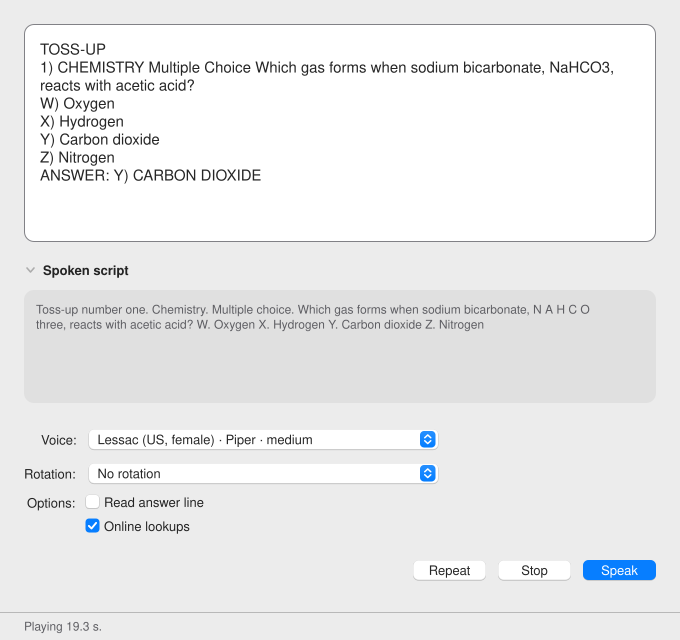

# Cloudy Reader

Cloudy Reader reads US DOE National Science Bowl questions aloud on your Mac. It uses local text-to-speech voices and says chemistry and biology terms with science-aware pronunciation.

## Download

- Get the disk image from the [v0.0.3 release page](https://github.com/Kiwee-Co/CloudyReader/releases/tag/v0.0.3).
- The file is `Cloudy-Reader-0.0.3-macos-arm64.dmg`. It needs an Apple Silicon Mac with macOS 26.2 or later.
- Open the disk image and drag Cloudy Reader onto the Applications link. The zip, `Cloudy-Reader-0.0.3-macos-arm64.zip`, holds the same app.
- Neither file holds voices or engines. The app downloads them at the first launch, so keep the Mac online.
- The app is ad-hoc signed and not notarized. The first launch needs a one-time approval in **System Settings > Privacy & Security**.
- Check the SHA-256 on the release page before you open the app.

[](https://github.com/Kiwee-Co/CloudyReader/actions/workflows/ci.yml)
[](https://github.com/Kiwee-Co/CloudyReader/blob/main/LICENSE)
[](https://kiwee-co.github.io/CloudyReader/manual/getting-started/)
[](pyproject.toml)
[](https://github.com/astral-sh/ruff)
[](https://kiwee-co.github.io/CloudyReader/)
[](https://kiwee-co.github.io/CloudyReader/developer/testing/)

<picture>
  <source media="(prefers-color-scheme: dark)" srcset="site/public/img/window-dark.svg">
  
</picture>

## Features

- **Reads questions as you paste them.** The parser handles toss-ups and bonuses, multiple choice (W, X, Y, Z), short answer, and the answer line. It cleans PDF leftovers: hard wraps, page footers, round titles, and glued headers.
- **Two local voice engines.** Piper provides 5 pinned English voices. Kokoro-82M on MLX adds 28 more on Apple Silicon. The project pins 33 voices in all.
- **Science-aware speech.** Formulas and ions are spelled (`H2O` becomes "H two O"). Units, fractions, scientific notation, exponents, and Greek letters become words. A pasted guide such as `[KREBZ SY-kul]` sets how a word sounds. A built-in lexicon covers hard science terms.
- **Voice rotation.** Choose No rotation, or pick a mode that changes the voice for each reading. The modes are round robin, random shuffle, US only, men only, and women only.
- **Optional name lookups.** PubChem and UniProt lookups are on by default. One checkbox, the `--offline` flag, or `CLOUDYREADER_OFFLINE=1` turns them off.
- **Background voice download.** Missing pinned voices download over HTTPS. The app checks every file against a pinned SHA-256 value.
- **Native macOS window.** The Qt (PySide6) window follows the light and dark appearance. It has the standard menus and keyboard shortcuts.
- **Self-test.** `cloudyreader --self-test` reads a sample question with no window and no sound, and checks the audio.

## Quick start

The commands in this README are untested: CI does not run them.

### Requirements

- A Mac with Apple Silicon. The packaged app is arm64 only.
- macOS 26.2 or later for the built app. The build writes this floor into the app's `Info.plist`.
- Python 3.12, [uv](https://docs.astral.sh/uv/), and GNU Make.
- Network access for the first setup. Daily use works offline.

### Run from source

```bash
git clone https://github.com/Kiwee-Co/CloudyReader.git
cd CloudyReader
make setup   # install dependencies, the NER model, and five Piper voices
make run     # start the app; its data lives in ./.data
```

Run `make kokoro` to add the Kokoro engine. Run `make doctor` for a read-only health check.

### Build the app

```bash
make setup
make app     # writes "dist/Cloudy Reader.app", ad-hoc signed
```

`make app` bundles Kokoro when you ran `make kokoro` first. Copy the app to `/Applications`. A downloaded copy needs a one-time approval in System Settings > Privacy & Security. See [Get started](https://kiwee-co.github.io/CloudyReader/manual/getting-started/).

## Usage

1. Open Cloudy Reader.
2. Paste a National Science Bowl question into the box.
3. Choose a voice in **Voice**, or choose a mode in **Rotation**.
4. Press **Speak** (Cmd+Return).
5. Press **Repeat** (Cmd+R) to hear it again, **Stop** (Cmd+.) to silence it, or open **Spoken script** to read the words that were spoken.

## Voices and rotation

| Rotation mode | The next voice comes from |
| --- | --- |
| No rotation | The voice you chose in **Voice**. |
| Round robin | The installed voices in menu order. After the last voice, it starts over. |
| Random shuffle | A shuffled deck of all installed voices. No voice repeats until the deck is empty. |
| US only (random shuffle) | The same deck, limited to en-US voices. |
| Men only | The same deck, limited to male voices. |
| Women only | The same deck, limited to female voices. |

Rotation uses installed, single-speaker English voices with a known gender. **Repeat** replays the last audio, so it keeps that voice. Details: [Voices and rotation](https://kiwee-co.github.io/CloudyReader/manual/voices/).

## Offline and privacy

- Parsing, pronunciation, entity detection, speech synthesis, and playback run on your Mac.
- The app uses the network for two things only: name lookups at PubChem and UniProt, and downloads of missing pinned voices from Hugging Face.
- A lookup sends the name of a chemical, protein, or gene. It never sends the surrounding text.
- `--offline` or `CLOUDYREADER_OFFLINE=1` stops both: no lookup request and no download.
- The code has no telemetry, analytics, crash reporting, or update check.

Details: [Offline and privacy](https://kiwee-co.github.io/CloudyReader/manual/offline-and-privacy/).

## Documentation

Read the full manual and the developer guide at **<https://kiwee-co.github.io/CloudyReader/>**.

- Manual: [Get started](https://kiwee-co.github.io/CloudyReader/manual/getting-started/), [Use the app](https://kiwee-co.github.io/CloudyReader/manual/using-the-app/), [Voices and rotation](https://kiwee-co.github.io/CloudyReader/manual/voices/), [Pronunciation](https://kiwee-co.github.io/CloudyReader/manual/pronunciation/), [Offline and privacy](https://kiwee-co.github.io/CloudyReader/manual/offline-and-privacy/), [Settings and command line](https://kiwee-co.github.io/CloudyReader/manual/settings-and-cli/), [Troubleshooting](https://kiwee-co.github.io/CloudyReader/manual/troubleshooting/), [FAQ](https://kiwee-co.github.io/CloudyReader/manual/faq/).
- Developer: [Build the app](https://kiwee-co.github.io/CloudyReader/developer/building/), [Architecture](https://kiwee-co.github.io/CloudyReader/developer/architecture/), [Test and CI](https://kiwee-co.github.io/CloudyReader/developer/testing/), [Contribute](https://kiwee-co.github.io/CloudyReader/developer/contributing/).

## Development

Run `make help` to list every target and variable.

| Command | What it does |
| --- | --- |
| `make setup` | Sync dependencies, install the NER model, and fetch the five Piper voices. |
| `make run` | Start the app with `CLOUDYREADER_DATA_DIR` set to `.data`. |
| `make kokoro` | Add the Kokoro engine (Apple Silicon only). |
| `make doctor` | Print a read-only health report with the fix for each missing item. |
| `make test` | Run the gate tests with a 75 percent coverage floor. |
| `make check` | Run `ruff check` and `ruff format --check`. |
| `make fmt` | Run `ruff format` and `ruff check --fix`. |
| `make guards` | Run the policy guards: vendor domain, lock hosts, disk paths, and workflow triggers. |
| `make ci` | Run `guards`, `check`, `test`, then `precommit`. This is the commit gate. It needs `shellcheck`, `prettier`, and `markdownlint` on the `PATH`. |
| `make app` | Build `dist/Cloudy Reader.app`. |

## Contributing

Changes land through pull requests. The `main` branch is protected, and the required status check `ci` must pass. Run `make ci` before you push. Read [Contribute](https://kiwee-co.github.io/CloudyReader/developer/contributing/) for the flow and the commit style.

## Third-party notices

The source of Cloudy Reader is licensed under Apache-2.0. The built `.app` also bundles third-party components that keep their own licenses.

Several of them are GPL components. They include `piper-tts` (GPL-3.0-or-later) and the `jdk4py` Java runtime (GPL v2). A build with Kokoro adds `phonemizer-fork` (GPLv3 or later). Distributing the `.app` is subject to those licenses. Read each project's license before you redistribute the `.app`.

The license names below come from the package metadata of the versions that `pyproject.toml` and `uv.lock` pin. This table is not legal advice.

| Component | Role in Cloudy Reader | License |
| --- | --- | --- |
| [Piper](https://github.com/OHF-voice/piper1-gpl) (`piper-tts` 1.8.0) | Piper engine; includes espeak-ng phonemization | GPL-3.0-or-later |
| [phonemizer-fork](https://pypi.org/project/phonemizer-fork/) 3.3.2 | Phonemization for Kokoro (Kokoro extra) | GPLv3 or later (package classifier) |
| [Piper voices](https://huggingface.co/rhasspy/piper-voices) | The 5 pinned voices, downloaded or bundled | Set per voice; read each model card |
| [Kokoro-82M](https://huggingface.co/mlx-community/Kokoro-82M-bf16) (MLX conversion) | Kokoro model and 28 voices | Set by the model card |
| [MLX](https://github.com/ml-explore/mlx) 0.32.4 and [mlx-audio](https://github.com/Blaizzy/mlx-audio) 0.6.3 | Run Kokoro on Apple Silicon | MIT |
| misaki 0.9.4 | Phoneme markup for Kokoro | Apache License 2.0 |
| [spaCy](https://spacy.io) 3.7.5 | Runtime for the NER model | MIT |
| [scispaCy](https://allenai.github.io/scispacy/) 0.6.2 and [`en_ner_craft_md`](https://allenai.github.io/SciSpaCy/) 0.5.4 | The scientific NER model (trained on CRAFT) | scispaCy: Apache Software License. Model: CC BY-SA 3.0 |
| [OPSIN](https://github.com/dan2097/opsin) through [py2opsin](https://github.com/JacksonBurns/py2opsin) 1.2.0 | Parse IUPAC names | py2opsin: MIT |
| [jdk4py](https://github.com/activeviam/jdk4py) 25.0.2.1 | Java runtime that runs OPSIN | GPL v2 (package classifier) |
| [Qt for Python (PySide6)](https://pyside.org) 6.12.0 | The window | LGPL-3.0-only OR GPL-2.0-only OR GPL-3.0-only |
| [ONNX Runtime](https://onnxruntime.ai) 1.31.1 | Runs Piper voices | MIT |
| [httpx](https://github.com/encode/httpx) 0.28.1 | HTTP client for lookups and downloads | BSD-3-Clause |
| [PyInstaller](https://pyinstaller.org) 6.22.3 | Builds the `.app` | GPLv2-or-later with a build exception |
| [PubChem](https://pubchem.ncbi.nlm.nih.gov) | Optional name lookups | Service terms apply |
| [UniProt](https://www.uniprot.org) | Optional name lookups | Service terms apply |
| [Hugging Face](https://huggingface.co) | Hosts the pinned voice files | Service terms apply |

The optional Kokoro extra also installs `en-core-web-sm`, `espeakng-loader`, and `num2words`. Check their licenses upstream.

## License

Cloudy Reader is licensed under the [Apache License 2.0](https://github.com/Kiwee-Co/CloudyReader/blob/main/LICENSE). The built `.app` also ships GPL components, such as `piper-tts` and `jdk4py`, plus `phonemizer-fork` in a build with Kokoro. Distributing the `.app` is subject to their licenses. See [Third-party notices](#third-party-notices).

## Affiliation

Cloudy Reader is an independent project. It is not affiliated with, endorsed by, or sponsored by the U.S. Department of Energy or the National Science Bowl.
